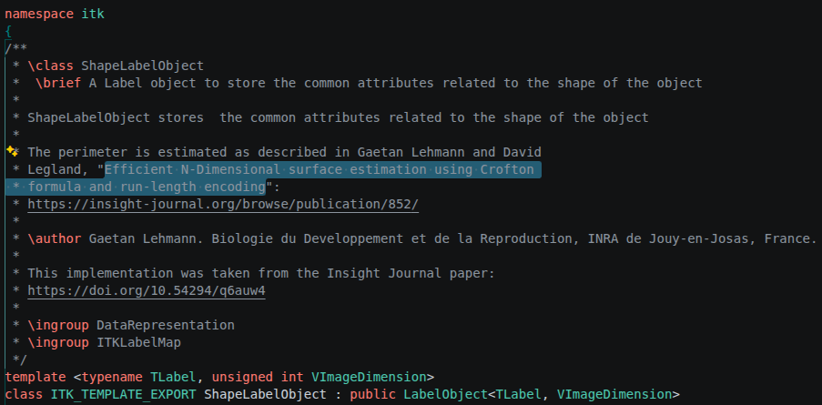

# Contribution: [Issue Title]

Path: `beat-2-contribution/contribution-story.md`

This file is Assignment 5, and it is graded at the path above; a copy kept anywhere else in
the repository is not read. **Keep every section header below under its exact name** — the
format criteria grade exactly that. Your course repo link is the whole submission: no tool
files and no evidence uploads are part of Assignment 5.

**Contribution Number:** [1]

**Student:** Josh Borthick

**GitHub Username:** joshb019919

**Issue:** https://github.com/InsightSoftwareConsortium/ITK/issues/470

**Pull Request:** https://github.com/InsightSoftwareConsortium/ITK/pull/7159

One repository, built across units 5 to 8, telling the whole story of your real
contribution. Fill it as you work, not at the end — the sections below ask for evidence that
is far easier to write down as it happens than to reconstruct in the last weekend.

Contribution Number stays `[1]` unless you make more than one contribution this term; it
just numbers them.

---

## Toolkit

Every story section below, from Why I Chose This Issue through Pull
Request, ends with a Toolkit block: which tool did that phase's work
and how you used it, what it produced, what difficulties or
shortcomings it presented, and what you changed or would change
because of them. Together the blocks are the thread the rubric's
Toolkit points read, and they are the raw material for your unit-9
portfolio, so keep them current as you work rather than
reconstructing them later.

A Toolkit block looks like this (copy it into each story section and
fill it there):

```text
**Toolkit**

- Tool: [which tool did this phase's work, and how you used it]
- What it produced: [described in a sentence or a short excerpt]
- Difficulties: [what fought you or fell short, or "none met"]
- What changed: [the patch, revision, or workaround, what you would
  update, or "nothing"]
```

This section also keeps one short dated entry per week of tool work,
starting below: what you built or changed that week, what broke, and
what you changed because of it. The blocks tell the story where it
happened; these entries are the toolkit's own timeline.

All four entries are graded. Keep every heading below, and fill each
one in the week it belongs to.

**Unit 5: Wrote the `gh` query and ranking filters in search-strategy.md then selected an issue with issue-scout**

**11/3/2026**

For the activity, I chose the query `gh search issues --language python --state open --no-assignee --label "good first issue" --created ">2026-11-01" --json title,repository,labels,createdAt,updatedAt,commentsCount,url --limit 100` because it uses the language I want, is likely unpicked and good for beginners' first issue, isn't assigned, and recent enough to hopefully be actively maintained.  I wrote other queries for Java, Go, and C++ too, but they're commented out in case I wanted to try another language.  My filters preferred 0 comments, work involving AI models, and only issues in English.  Nothing broke really, all the issues the scout returned were interesting, passed the rubric and filters, and are issues I could work on with Claude.

**Unit 6: Drafted a claim comment and checked it with repro-check.**

I added the required check to the voice-guard, did the symlinking.  I did the repo-memory file.  Otherwise, I copied everything that was already there into the new files.  The only things that broke anything were my claim comment formats, which I altered till it passed.

**Unit 7: [one line on the tool work]**

[2-4 sentences: the ship-gate and your gate manifest. What it produced
on your real branch, what fought you, what changed because of it.]

**Unit 8: [one line on the tool work]**

[2-4 sentences: the PR-monitor and your playbook. What it read, what it
drafted, what you did with the draft.]

---

## Why I Chose This Issue

I first tried a wild repo that I'd found from a regular filtered search, but was told it wasn't a big enough project and didn't have enough hands in it to count.  I then went through about 50 curated issues with filters "python" and "good first issue" to find one that passed my issue-scout (most were already claimed, had PRs or assignees, or weren't maintained).  I settled on one that seemed easy enough (classification of **straightforward**) and didn't have any claims.  

I was going to find a complex one to do, but realized that I was running out of time in this course.  This does fit my profile so well because it isn't challenging or involving Python, Rust, or the other things I wanted to work on.  This is a selection of convenience because I'm running out of time.  Actually though, I hope to learn how to run this ITK tool and some of the inner workings of its codebase, perhaps even ingratiate myself to the maintainers and owners and be allowed to work with them in earnest.

The verdict was "accept".  The fix itself is a rather simple documentation addition.

**Claim Link**
`https://github.com/InsightSoftwareConsortium/ITK/issues/470#issuecomment-6828340620`

**Toolkit**

- Tool: issue-scout (your scout: your search strategy, your rubric),
  and how you used it
- What it produced: 

```JSON
  {
  "item": "https://github.com/InsightSoftwareConsortium/ITK/issues/470",
  "checks": [
    {"name": "Recent default-branch commits", "grade": "pass", "evidence": "newest default-branch commit 2026-11-12 (hjmjohnson)"},
    {"name": "Release recency", "grade": "pass", "evidence": "v5.4.7 published 2026-08-10"},
    {"name": "Archived flag", "grade": "pass", "evidence": "archived:false"},
    {"name": "Assignee", "grade": "pass", "evidence": "assignees: []; sjh26 unassigned 2021-08-18"},
    {"name": "Linked PRs", "grade": "pass", "evidence": "no PRs reference the issue; PR search for ShapeLabelMapFilter perimeter returned only unrelated #6521"},
    {"name": "Claim comments", "grade": "pass", "evidence": "3 comments, all Feb 2019; none are claims within 6 months"},
    {"name": "Contribution policy", "grade": "pass", "evidence": "CONTRIBUTING.md has no AI restriction; Documentation/AI/ rules set disclosure conditions only"},
    {"name": "Dedicated AI policy files", "grade": "pass", "evidence": "AGENTS.md and Documentation/AI/*.md are conditions (disclose in PR, no AI Co-Authored-By), not a ban"},
    {"name": "Scope Feasible", "grade": "pass", "evidence": "one task: add link http://hdl.handle.net/10380/3342 to LabelObject perimeter docs; link absent from tree (code search: 0 results)"},
    {"name": "Locally Runnable", "grade": "pass", "evidence": "comment-only change; no stated difficulty"}
  ],
  "verdict": "accept"
  }
```

- Difficulties:  Difficulty was in finding an unclaimed issue on a repo that was actively maintained and wasn't someone's side project.
- What changed: I just keep trying repos from the curated issues selected by CodePath after adding the "Locally Runnable" check to the rubric to avoid an issue with another repo being something that required a supercomputer.

---

## Understanding the Issue

**Problem Description**

The class `ShapeLabelMapFilter` needed to also cite _Insight Journal publication 852, "Efficient 
N-Dimensional surface estimation using Crofton formula and run-length encoding"_ alongside it's citation already present.

**Expected Behavior**

It needs updated to cite that paper.

**Current Behavior**

It doesn't cite that paper.

**Affected Components**

The `ShapeLabelMapFilter` class in `ITK/Modules/Filtering/LabelMap/include/itkShapeLabelMapFilter.h`.

**Toolkit**

- Tool: issue-scout and voice-guard
- What it produced: Failure at first, then I found an issue that passed and altered the claim, commit, and PR messages till they passed the guard
- Difficulties: Finding an acceptable issue
- What changed: The `ShapeLabelMapFilter` docstring.

---

## Reproduction Process

**Environment Setup**

- **OS:** Ubuntu 26.04.1 LTS.
- **Kernel:** Linux 7.0.0-43-generic.
- **Architecture:** x86_64.
- **ITK:** `v6.0b02-6872-g2e3a1eb760` (development).
- **Toolchain:**
  - **Package Manager:** Pixi (conda-forge).
  - **Langauges:**
    - Python `>=3.13.5,<3.14`.
    - C++ `>17`.
  - **Dependencies:**
    - CMake `>=4.0.3,<5`.
    - Ninja `>=1.13.0,<2`.
    - ccache `>=4.13.6,<5`.
    - pre-commit `>=4.1.0,<5`.
- **Setup:**
  - `pixi install`.
  - `pixi run --as-is build`.
- **Challenges:** I have not built or run ITK's tests because Pixi is not on my machine (I don't have Conda).  Nothing in this change needs a build.

**Steps to Reproduce**

1. Fork InsightSoftwareConsortium/ITK.
2. Clone to local machine.
3. Observe that `ITK/Modules/Filtering/LabelMap/include/itkShapeLabelMapFilter.h` and `ITK/Modules/Filtering/LabelMap/include/itkShapeLabelobject.h` class headers have no citations for the paper, "Efficient N-Dimensional surface estimation using Crofton formula and run-length encoding".

**Reproduction Evidence**

- **Commit showing reproduction:** https://github.com/joshb019919/ITK/commit/2e3a1eb7600d153cb71e3b6b7e69163d3ab108b5.
- **Screenshots/logs:** 
- **My findings:** The "reproduction" is a simple cloning of the repo that let me check the appropriate files' lack of that citation in their class docstrings.

**Toolkit**

- **Tool:** `gh api` to read the issue and its comments, and `grep` over the LabelMap headers; Claude Code ran both and summarized.
- **What it produced:** the issue text and four comments, and the grep showing no paper citation in the headers.
- **Difficulties:** `gh issue view` failed (Projects classic deprecation error).
- **What changed:** switched to `gh api`.

---

## Solution Approach

**Analysis**

[Your analysis of the root cause: what is causing the issue, traced
to the files and functions involved.]

**Proposed Solution**

Add the citations to the docstrings of `ShapeLabelObject` and `ShapeLabelMapFilter` class headers.

**Implementation Plan**

1. [Modify file X to do Y]
2. [Add or change Z]
3. [Update tests]

[Record deviations here as they happen: what changed mid-build and
why. A recorded deviation is honest work; silent drift is not.]

**Toolkit**

- Tool:
- What it produced:
- Difficulties:
- What changed:

---

## Testing Strategy

[What observable checks prove the fix: your reproduction steps re-run
against the built change (before and after), and the repo's own test
suite or checks with the outcome shown. "Tests pass" with nothing
observable named is not a strategy.]

**Toolkit**

- Tool:
- What it produced:
- Difficulties:
- What changed:

---

## Implementation Notes

[A running log, added to as you work. Date each entry. What you
built, decisions you made when you made them, wrong turns included.]

**[Date]**

[Entry]

**[Date]**

[Entry]

**Toolkit**

- Tool:
- What it produced:
- Difficulties:
- What changed:

---

## Pull Request

**PR Link:** [GitHub PR URL when opened]

**PR Description:** [what the PR says; much of the content above
adapts into it]

**Maintainer Feedback:**

- [Date]: [feedback received, or "none yet"; silence is a normal
  state and costs you nothing]
- [Date]: [how you addressed it]

**Status:** [Awaiting review / Iterating / Merged / Closed. The
status is a fact you record, never a grade: the PR is graded as
opened.]

**Toolkit**

- Tool:
- What it produced:
- Difficulties:
- What changed:

---

## Learnings and Reflections

**Technical Skills Gained**

[What you learned technically, named concretely.]

**Challenges Overcome**

[What was hard and how you solved it; point at the real events, the
Toolkit blocks above are full of them.]

**What I'd Do Differently Next Time**

[Reflection on your process.]

---

## Resources Used

[What actually helped, not a reading list. List things this story
already shows you using: the doc you followed to set the environment
up, the thread that explained the bug, the person who answered you.
One real entry beats ten plausible ones.]

- [Link to documentation that helped]
- [Discussion, issue, or post that helped]
